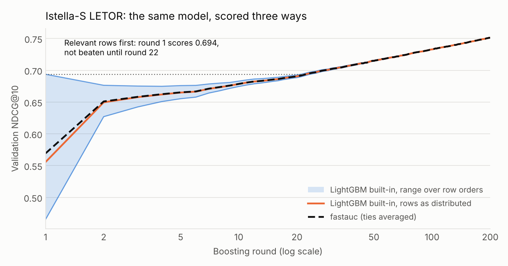
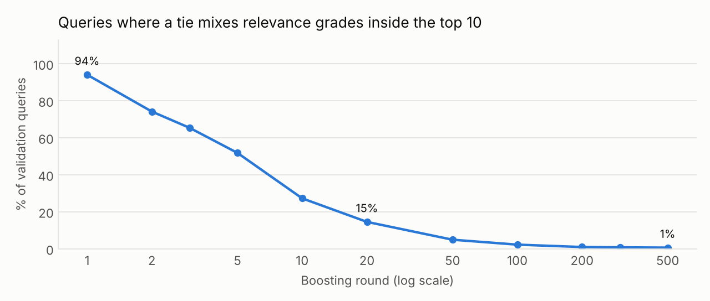

# Case study: row order in LightGBM's NDCG

On Istella-S LETOR, LightGBM's own validation NDCG@10 after the first
boosting round is anywhere from **0.465 to 0.694**, depending only on the
order of the rows within each query. The model and its predictions are the
same; fastauc reports 0.569 for every order. When the relevant rows come
first, early stopping with a patience of 10 rounds stops at round 1 and
keeps a model with test NDCG@10 of **0.564 instead of 0.762**.

## Setup

- **Data:** [Istella-S LETOR](https://doi.org/10.1145/2987380) (Dato et al., ACM TOIS 2016), 220 features, relevance grades 0 to 4. Training: 19,245 queries, 2,043,304 documents. Validation: 7,211 queries, 684,076 documents. Test: 6,528 queries, 679,749 documents (34 test queries without any relevant document are dropped, because LightGBM scores them 1.0 and fastauc leaves them out). The archive is checked against the size and SHA-256 published by TensorFlow Datasets.
- **Model:** LightGBM 4.7.0, `lambdarank`, learning rate 0.05, 63 leaves, 500 rounds, seed 0, deterministic.
- **Three validation sets** with the same rows, differing only in the order of rows inside each query: as distributed, relevant rows first (sorted by grade, highest first), relevant rows last. Training never sees them, so one model is scored three ways.
- **Check:** a by-position NDCG@10 (stable sort, ties keep input order) reproduces LightGBM's built-in value to within 1e-9 at every checkpoint, so the differences below are LightGBM's own numbers.

## Results



| Round | Relevant first | As distributed | Relevant last | fastauc | Queries with a mixed-grade tie in the top 10 |
|---:|---:|---:|---:|---:|---:|
| 1 | 0.694 | 0.556 | 0.465 | 0.569 | 94.1% |
| 2 | 0.676 | 0.650 | 0.627 | 0.651 | 74.2% |
| 5 | 0.676 | 0.665 | 0.655 | 0.665 | 51.8% |
| 10 | 0.683 | 0.678 | 0.674 | 0.679 | 27.2% |
| 20 | 0.693 | 0.690 | 0.688 | 0.690 | 14.5% |
| 50 | 0.716 | 0.715 | 0.714 | 0.715 | 4.9% |
| 100 | 0.733 | 0.733 | 0.733 | 0.733 | 2.2% |
| 500 | 0.769 | 0.769 | 0.769 | 0.769 | 0.6% |

The first trees put most documents of a query into a few leaves, so
predictions tie heavily: after round 1, 94% of validation queries have a
tied block in the top 10 that mixes relevance grades, which is exactly where
the order of rows decides the metric. The spread between the two extreme
orders is above 0.01 until round 9 and above 0.001 until round 70. Even the
order as distributed is off by 0.014 at round 1.



## Early stopping

| Patience | Relevant first | As distributed | Relevant last | fastauc |
|---:|---|---|---|---|
| 10 | **round 1, test 0.564** | round 488, test 0.762 | round 488, test 0.762 | round 488, test 0.762 |
| 25 | round 488, test 0.762 | round 488, test 0.762 | round 488, test 0.762 | round 488, test 0.762 |
| 50 | round 488, test 0.762 | round 488, test 0.762 | round 488, test 0.762 | round 488, test 0.762 |

With the relevant rows first, round 1 scores 0.694 because every tie breaks
in the model's favour, and that inflated value is not beaten until round 22.
A patience of 10 rounds stops there. Click logs often list clicked items
first, so this layout is not hypothetical.

## Low-precision scores

Rounding the final model's test predictions to bfloat16, as low-precision
serving or evaluation does, brings ties back: documents in tied blocks go
from 1.6% to 33.8%, and queries with a mixed-grade tie in the top 10 from
0.7% to 9.3%. NDCG@10 by position then spans 0.7609 to 0.7624 across row
orders; fastauc gives 0.7616.

## Limits

One dataset, one seed and one learning rate. Relevant-first and
relevant-last are the extreme layouts, and real logs fall in between. A
larger learning rate or deeper trees resolve ties sooner. The late-training
numbers, and the test score of a model trained to convergence, are not
affected; learning curves, short-patience early stopping and low-precision
scoring are.

The problem is long known in IR evaluation: Microsoft's own LETOR evaluation
script sorts tied documents by their order in the input file
([LETOR 3.0](https://www.microsoft.com/en-us/research/project/letor-learning-rank-information-retrieval/letor-3-0/)).

## Reproduce

```bash
pip install pyfastauc lightgbm scikit-learn
curl -LO http://library.istella.it/dataset/istella-s-letor.tar.gz
tar -xzf istella-s-letor.tar.gz
python benchmarks/case_study.py --data sample --name "Istella-S LETOR" --out results.json
python benchmarks/plot_case_study.py results.json case_study
```

The [Case study workflow](https://github.com/hen-ml/fastauc/actions/workflows/case-study.yml)
runs the same steps on GitHub Actions; the raw results are in
`benchmarks/results/case_study_istella_s.json`. The script also takes
MSLR-WEB10K (`--data MSLR-WEB10K/Fold1`), which requires accepting
Microsoft's dataset agreement before download.
